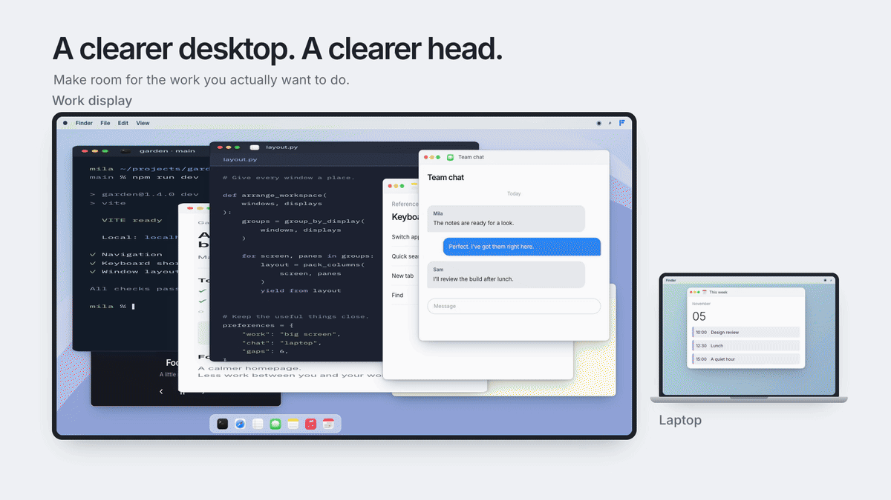

<p align="center"></p>
<h1 align="center">Fenlet</h1>
<p align="center">A little room to think. Arrange your Mac windows, then get back to work.</p>
<p align="center">
  <a href="#get-started">Get started</a> ·
  <a href="#with-an-agent">For agents</a> ·
  <a href="docs/reference.md">CLI reference</a> ·
  <a href="docs/operating.md">Setup & privacy</a>
</p>

Fenlet turns the windows you are using into non-overlapping panes. Keep a
browser beside your terminal, put chat on another screen, and set aside the
rest. It adapts to a laptop alone, several displays, and portrait monitors.

A small native widget, a CLI, and an agent skill share the same planner.
Click **Arrange windows**, adjust the draft by dragging tiles, then
**Confirm arrangement**. Nothing moves or closes before confirmation.

<p align="center"></p>
<p align="center"><sub>Demo uses synthetic windows and example content. Real window images stay on your Mac.</sub></p>

## Get started

**[Download Fenlet for Apple Silicon](https://github.com/2018kguo/fenlet/releases/latest/download/Fenlet-macos-arm64.zip)** ·
[Releases & checksums](https://github.com/2018kguo/fenlet/releases)

Unzip it, move **Fenlet.app** into Applications, and open it. Setup guides you
through Accessibility permission, your provider key, and optional window
previews. Choose **Install CLI & skill** in Settings for terminal and agent use.

macOS 13+; real window thumbnails need macOS 14+ and Screen Recording permission.
The app includes its runtime. No Homebrew, Python install, browser extension,
or background server is needed.

This first public preview is **Developer ID signed, not notarized**. macOS may
ask you to approve the app in Privacy & Security. See [first-launch instructions](docs/operating.md#first-launch).

To build from source:

```sh
git clone https://github.com/2018kguo/fenlet.git
cd fenlet
bash scripts/install.sh
open "$HOME/Applications/Fenlet.app"
```

The source build needs Apple's Command Line Tools; the installer opens Apple's
setup when they are missing. The [development guide](docs/development.md)
covers builds, verification, and releases.

## Make it yours

- **Tall, readable panes.** Tight 6-point gaps, native app minimums, and
  physical display dimensions guide placement. Text panes favor 6–8 inches
  of width when space permits; narrow portrait screens use their height.
- **Review the whole workspace.** Work, chat, and reference displays can be
  Automatic or selected in Settings. Windows marked **To minimize** or
  **To close** remain visible in the draft. Drag one back to keep it on screen.
- **Keep your choices.** Already fitting tiles retain their order. Repeat
  previews reuse confirmed placements while the windows, positions, and
  instructions still match.
- **A quiet menu-bar app.** Live thumbnails refresh while it is open and stop
  when it closes. Drag edits run locally, without a model call. Window
  arrangement uses native batched operations without activating or raising apps.

## From the terminal

```sh
fenlet plan "Browser beside my terminal. Chat on another screen."  # review first
fenlet apply PLAN_PATH --yes
fenlet arrange --yes       # plan and apply in one run
fenlet undo JOURNAL_PATH

fenlet tile                # offline pane preview
fenlet snap left           # focused window, no model
fenlet check               # actual OS overlap report
```

Commands return JSON. The CLI can also edit saved drafts, choose displays,
check setup, and install the skill. See the [CLI reference](docs/reference.md).

## With an agent

Install the bundled skill from Settings, or use the public skill directory:

```sh
npx skills add 2018kguo/fenlet --skill fenlet
```

Then ask:

> Use Fenlet to tile my current work without overlaps. Keep the browser beside
> my terminal, chat on another display if there is one, and minimize useful
> background windows. Close idle clutter.

The skill uses the same CLI and verified operation journal as the widget.
The [skill instructions](skills/fenlet/SKILL.md) explain preview, confirmation,
background windows, and Undo.

## Models and privacy

**Jev 1.14** is the fast default. Optional Nemotron, Beam, and a Jev-to-Nemotron
escalation mode are available. Models classify window purpose; local code
owns geometry and every OS action. Confirmed layouts and identical recent
requests avoid unnecessary model calls.

App names, window titles, and your instructions go to your chosen provider.
Screenshots and document contents do not. Keys stay in Keychain. Fenlet does
not scan or modify Desktop files. There is no telemetry or background model loop.

[Setup, privacy, and limitations](docs/operating.md) ·
[Small synthetic model benchmark](benchmarks/2026-11-05-synthetic.json) ·
[CPU benchmark](benchmarks/2026-11-05-cpu.json)

## Development

SwiftUI/AppKit for the widget; Python's standard library for layout; Swift
Accessibility and CoreGraphics for OS control. No Electron or Python packages.

```sh
python3 -m unittest discover -v
bash scripts/build-app.sh
python3 scripts/verify-bundle.py build/Fenlet.app
```

CI runs the planner tests on Linux and builds and smoke-tests the portable app
on macOS. Native window and GUI checks use disposable fixtures on a local Mac;
they require desktop permissions and are separate from hosted CI.
[Development, demo reproduction, and releases](docs/development.md).

[MIT](LICENSE) · [Bundled runtime notices](THIRD_PARTY_NOTICES.md)
